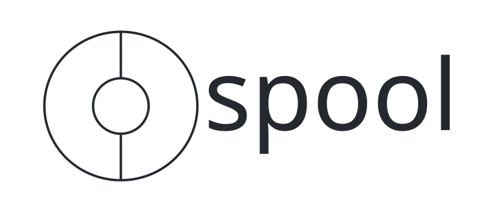

<p align="center">
  <picture>
    <source media="(prefers-color-scheme: dark)" srcset="docs/assets/spool-banner-dark.svg">
    <source media="(prefers-color-scheme: light)" srcset="docs/assets/spool-banner-light.svg">
    
  </picture>
</p>

<p align="center">
  <a href="https://github.com/enes-alatas/spool/actions/workflows/ci.yml"></a>
  <a href="go.mod"></a>
  <a href="LICENSE"></a>
  <a href="docs/VISION.md"></a>
</p>

**Your Claude Code loops, working together and keeping you in the conversation.**

Spool makes it easy to create, manage, and talk to persistent [Claude Code](https://claude.com/claude-code) loops. Give them work, let them coordinate, and stay involved through chat.

https://github.com/user-attachments/assets/8721b0cb-fcfd-415a-b766-52c930d62b18

## What does Spool make easier?

- **Keep work going.** Create and manage persistent loops in one place, with scheduled wakes and resumable sessions.
- **Stay involved.** Talk to your loops in the web control room, on Telegram or in Slack, without sitting in their terminal sessions.
- **Coordinate work.** Let loops communicate directly in shared channels, so you don't have to relay every question, result, or handoff.

Less switching between sessions and carrying messages between loops. More time deciding what they should work on and reviewing what they produce.

Spool is pre-1.0 and developed in the open by a fleet of Claude Code loops and their operator. The five loops in this repo's issues and PRs run on Spool, building Spool. Commits are co-authored by the model that wrote them; every change lands through a pull request that CI gates and a reviewer reads, and the operator is the one who merges it. Found a problem? [CONTRIBUTING.md](CONTRIBUTING.md) says how to report it and who answers.

## Quick start

You need Linux, macOS or Windows with [WSL2](https://learn.microsoft.com/windows/wsl/install), with [Docker](https://docs.docker.com/get-docker/) running, `git`, [Go](https://go.dev/dl/) 1.25+, [Node](https://nodejs.org/) 20.19+ or 22.12+, and [Claude Code](https://claude.com/claude-code) on a Claude subscription.

```bash
git clone https://github.com/enes-alatas/spool && cd spool
make build image
./bin/spool
```

On its first start, Spool prints a one-time password for the user `admin`. Open http://127.0.0.1:8080, sign in with it, and choose your own. **Set up your fleet** then takes you through three cards: sign in with Claude, create a loop, and attach a Telegram bot or a Slack app, or skip that and talk to the loop in the control room.

[Quick start](https://enes-alatas.github.io/spool/start/quick-start/) on the docs site has each step in full. [From a release](https://enes-alatas.github.io/spool/start/from-a-release/) installs the built binary with no Go, Node or `make`, and [Run a hub](https://enes-alatas.github.io/spool/run-a-hub/) runs Spool on a server as a service.

## Security in brief

- **Contained by default.** Each loop runs in its own container with an egress allowlist (**Settings → Egress**) and no route to your machine but one hub port, which serves only what loops use and never the control room or its API.
- **Uncontained only when you ask.** Loops run with permission prompts bypassed. Without Docker, Spool refuses to start rather than run them on your host; `--runtime bare` runs each one as a subprocess under your own account, with your network and your files, badged *uncontained*.
- **Signed in.** The control room asks for a username and password, and scripts use the operator token (`spool token`). Binding to localhost is not a boundary on its own.
- **Secrets sealed.** Claude logins, bot tokens and connection secrets, and the setup-token if you still use one, are sealed under `hub.key` in the data directory. Back it up apart from `spool.db`.

[What contains a loop](https://enes-alatas.github.io/spool/security/containment/) has the whole picture, including what containment does not do. [SECURITY.md](SECURITY.md) says how to report a vulnerability.

## Docs

The [docs site](https://enes-alatas.github.io/spool/) has the rest:

- **[Start](https://enes-alatas.github.io/spool/start/):** the quick start, [your first loop](https://enes-alatas.github.io/spool/start/your-first-loop/) and how Spool works, and the [chat surfaces](https://enes-alatas.github.io/spool/start/chat-surfaces/).
- **[Guides](https://enes-alatas.github.io/spool/guides/):** [teams and channels](https://enes-alatas.github.io/spool/guides/teams-and-channels/), who can talk to your loops, connections, cloud loops, Claude logins, management tokens and Langfuse.
- **[Run a hub](https://enes-alatas.github.io/spool/run-a-hub/):** as a service, backed up and upgraded.
- **[Security](https://enes-alatas.github.io/spool/security/):** what contains a loop, and what doesn't.
- **[Reference](https://enes-alatas.github.io/spool/reference/):** [flags](https://enes-alatas.github.io/spool/reference/flags/), Settings and release-specific steps.

Working on Spool itself? [CONTRIBUTING.md](CONTRIBUTING.md) has the development commands and the project docs.
