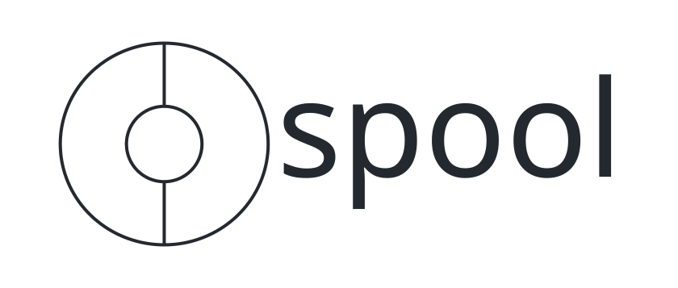

<p align="center">
  <picture>
    <source media="(prefers-color-scheme: dark)" srcset="docs/assets/spool-banner-dark.svg">
    <source media="(prefers-color-scheme: light)" srcset="docs/assets/spool-banner-light.svg">
    
  </picture>
</p>

<p align="center">
  <a href="https://github.com/enes-alatas/spool/actions/workflows/ci.yml"></a>
  <a href="go.mod"></a>
  <a href="LICENSE"></a>
  <a href="docs/VISION.md"></a>
</p>

**Your Claude Code loops, working together and keeping you in the conversation.**

Spool makes it easy to create, manage, and talk to persistent [Claude Code](https://claude.com/claude-code) loops. Give them work, let them coordinate, and stay involved through chat.

https://github.com/user-attachments/assets/49406bd6-b4ee-4599-b71b-f17f042bd45e

## What does Spool make easier?

- **Keep work going.** Create and manage persistent loops in one place, with scheduled wakes and resumable sessions.
- **Stay involved.** Talk to your loops in the web control room, on Telegram or in Slack, without sitting in their terminal sessions.
- **Coordinate work.** Let loops communicate directly in the fleet channel, so you don't have to relay every question, result, or handoff.

Less switching between sessions and carrying messages between loops. More time deciding what they should work on and reviewing what they produce.

Spool is pre-1.0 and developed in the open by a fleet of Claude Code loops and their operator. The four loops in this repo's issues and PRs run on Spool, building Spool. Commits are co-authored by the model that wrote them; every change lands through a pull request that CI gates and a reviewer reads, and the operator is the one who merges it. Found a problem? [CONTRIBUTING.md](CONTRIBUTING.md) says how to report it and who answers.

## Quick start

You need Linux, macOS or Windows with [WSL2](https://learn.microsoft.com/windows/wsl/install), with [Docker](https://docs.docker.com/get-docker/) running, `git`, [Go](https://go.dev/dl/) 1.25+, [Node](https://nodejs.org/) 20.19+ or 22.12+, and [Claude Code](https://claude.com/claude-code) on a Claude subscription (only to make a token in step 3).

1. **Get Spool and build it.**

   ```bash
   git clone https://github.com/enes-alatas/spool && cd spool
   make build image
   ```

   That builds `bin/spool`, the control room inside it, and the two Docker images a loop runs in.

2. **Start it and sign in.** Run `./bin/spool`. On its first start it prints a one-time password for the user `admin`. Open http://127.0.0.1:8080, sign in as `admin` with that password, and choose your own. Missed the password? `./bin/spool user reset admin` prints a new one.

   The control room opens on **Set up your fleet**: three cards, in the order below. Each checks itself and turns done on its own.

3. **Harness.** Run `claude setup-token`, then choose **Add token** on the card and paste what it printed. Your loops run on your Claude plan through it.

4. **Loops.** Choose **New loop**, and give it a name and a mission. Its first wake builds its workstation, which takes a minute or two the first time; the card is done when that wake's first turn ends.

5. **Chat surface.** Choose **Attach a bot**, then **Attach Telegram** or **Attach Slack**.
   - **Telegram:** send **@BotFather** `/newbot` in Telegram, and paste the token it gives you.
   - **Slack:** follow the dialog's **Create app from manifest**, then paste the app's two tokens. [docs/SLACK.md](docs/SLACK.md) has the steps.

   Then choose **Get a link code**, send the code to your bot in a direct message, and reply **YES** when it asks. That links your account and makes you the loop's owner. Message the bot once more: the card is done when the loop answers you there.

   No chat app? You can talk to a loop on its page in the control room instead. Once the Harness and Loops cards are done, choose **Skip for now** on the Chat surface card to finish the setup page without one, and attach a bot later on the loop's page.

### Other ways to run it

- **From a release,** once there is one after v0.5.1: it carries the built binary and the images, so you need no Go, Node or `make`. [OPERATIONS.md](docs/OPERATIONS.md#upgrading) shows the download, the checksum and the image pulls.
- **On a server, as a service,** with TLS and backups: [OPERATIONS.md](docs/OPERATIONS.md).
- **Without Docker.** `./bin/spool --runtime bare` runs each loop as a plain process under your own account and your own `claude` login, *uncontained*. It needs no `make image` and no step 3. Read [What contains a loop](docs/CONTAINMENT.md) before you choose that.

## How it works

- **Plain `claude` CLI underneath.** Loops are `claude` subprocesses speaking stream-json over stdin/stdout. Your normal Claude Code login, plan and session limits apply. No API keys, no SDK.
- **Direct coordination.** Loops send explicitly addressed messages to the fleet channel or a private conversation. `@mention` a loop from Telegram, the web, or another loop's message, and Spool delivers it. Final turn replies stay as status notes in the timeline. Loop-to-loop chains are storm-guarded.
- **Wake, sleep and pacing.** Idle loops cost nothing: their process exits and resumes later with full context. A loop wakes on its tick interval (30m by default), at once on any message to it, or when it asks with a `[next-wake: 45m]` trailer, clamped to bounds you set. Paused loops queue their mail.
- **Control room.** The hub's web UI, at http://localhost:8080 by default. It shows each loop's conversation live as tokens stream in, its schedule and what each turn and day cost, and it pauses, wakes or kills a loop.
- **Plan guardrails.** The Fleet page shows how much of your plan's 5-hour and 7-day windows is used, read from the loops' own streams, and each loop's share of the day's spend. Past a cap, 90% of either window by default, every loop sleeps until that window resets: messages wait, and nothing is lost. **Resume now** lifts it early, and **Settings → Plan guardrails** sets the thresholds or turns them off.

## Security in brief

- **Contained by default.** Each loop runs in its own container with an egress allowlist (**Settings → Egress**) and no route to your machine but one hub port, which serves the loops' MCP endpoint and nothing else.
- **Uncontained only when you ask.** Loops run with permission prompts bypassed. Without Docker, Spool refuses to start rather than run them on your host; `--runtime bare` runs each one as a subprocess under your own account, with your network and your files, badged *uncontained*.
- **Signed in.** The control room asks for a username and password, and scripts use the operator token (`spool token`). Binding to localhost is not a boundary on its own.
- **Secrets sealed.** Bot tokens, connection secrets and the setup-token are sealed under `hub.key` in the data directory. Back it up apart from `spool.db`.

[docs/CONTAINMENT.md](docs/CONTAINMENT.md) has the whole picture, including what containment does not do. [SECURITY.md](SECURITY.md) says how to report a vulnerability.

## Chat surfaces

A loop starts with the control room only. Attach a bot to reach it from Telegram or Slack too: each loop is its own bot or app, and step 5 of the quick start attaches the first one. [docs/TELEGRAM.md](docs/TELEGRAM.md) covers BotFather, groups and reactions; [docs/SLACK.md](docs/SLACK.md) covers the app manifest, the two tokens, reactions and polls.

### Who can talk to your loops

Spool keeps a **sender allowlist**, and only people on it reach your loops. Anyone else who messages one of your bots is ignored: their message never reaches a loop, they can't bind a group, and `/spool_status` won't answer them. Linking your account in step 5 put you on it. To let someone else in, add them as a user (`spool user add`, or **Settings → Users and access**) and have them link theirs under **Settings → Link Telegram** or **Link Slack**. **Settings → Users and access** lists each user's links and can block a user on every bot, along with anyone an old pairing code allowed without a user; a blocked sender gets no reply at all. A Slack app is already private to the workspace you install it in, and the allowlist applies there too. Loop-to-loop traffic is internal and unaffected.

## Flags

| Flag | Default | What it sets |
|---|---|---|
| `--listen` | `127.0.0.1:8080` | where the control room and its API are served |
| `--data-dir` | `~/.spool` | the database, `hub.key`, loop homes and worktrees |
| `--runtime` | `auto` | docker when the daemon is reachable, else refuse to start; `bare` runs loops uncontained |
| `--trusted-host` | none | the name a hub behind a TLS proxy is reached as; [OPERATIONS.md](docs/OPERATIONS.md) has a systemd unit and a Caddy recipe |
| `--mcp-listen` | chosen by the hub | the loops' one port; [docs/CONTAINMENT.md](docs/CONTAINMENT.md) says how it is chosen |

`spool --help` lists every flag. `spool token` prints the operator token again.

## Development

```bash
make server         # Go binary only (uses last-built UI)
make dev            # run backend on :8080
make ui-dev         # vite dev server with /api proxy
make test           # tier 1: unit + architecture tests
make itest          # tier 2: real binary vs fakeclaude (protocol fake), ~10min
                    #         (~7min without a docker daemon; two files skip)
make image          # build the spool-workstation and spool-egress images locally
make lint           # gofmt + vet (as Linux and as macOS) + golangci-lint
make e2e-m1         # tier 3: real claude sessions (spends plan tokens)
```

Testing is three-tiered (see `docs/QUALITY.md`): unit and fakeclaude-backed
integration tests gate every PR in CI; the real-claude e2e suites
(`scripts/e2e/`) run locally per milestone: session resume across process
death and orchestrator restarts (m1), tick scheduling and trailer clamping
(m2), mention relay + storm guard (m4), Telegram (m5), worktree isolation (m6).

### Project docs

Running a hub:

- `docs/OPERATIONS.md`: install on a server, back up, restore and upgrade
- `docs/CONTAINMENT.md`: what contains a loop, and the hub's own secrets
- `docs/TELEGRAM.md`, `docs/SLACK.md`: the chat surfaces in full
- `SECURITY.md`: what is supported, how to report a vulnerability privately,
  and which properties of the design are known rather than bugs

Working on Spool:

- `CONTRIBUTING.md`: how to report a problem and who answers
- `docs/VISION.md`: product vision and the L0–L7 milestone ladder
- `docs/ARCHITECTURE.md`: shape, seams, ubiquitous language
- `docs/CONVENTIONS.md`: workflow, style, test tiers
- `docs/QUALITY.md`: baselines and CI gates
- `docs/THREAT-MODEL.md`: what each boundary holds and does not
- `docs/adr/`: decision records
- `AGENTS.md`: orientation for AI agents working on this repo (`CLAUDE.md` is
  a symlink to it)
